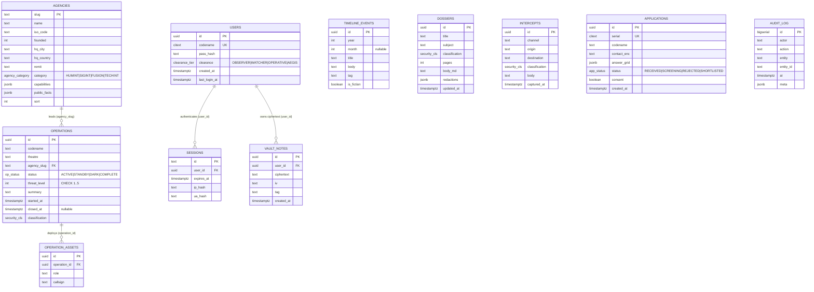

# AEGIS // OPS GRID — Database Schema, ERD & Governance (`DATABASE.md`)

> **UNOFFICIAL FAN CONCEPT // FICTIONAL 2087 SPECULATIVE INTERFACE**  
> This document defines the PostgreSQL 15+ database architecture, Entity-Relationship Diagram (Mermaid), DDL/Drizzle ORM schema, indexing strategy, Row-Level Security (RLS) policies, seed plan, and retention lifecycle for **AEGIS // OPS GRID**.

---

## 1. Entity-Relationship Diagram (Mermaid `erDiagram`)



---

## 2. PostgreSQL 15+ Extensions, Enums & DDL Specification

```sql
-- Required Extensions
CREATE EXTENSION IF NOT EXISTS "pgcrypto";
CREATE EXTENSION IF NOT EXISTS "citext";

-- Domain Enumerations
CREATE TYPE agency_category AS ENUM ('HUMINT', 'SIGINT', 'FUSION', 'TECHINT');
CREATE TYPE clearance_tier  AS ENUM ('OBSERVER', 'WATCHER', 'OPERATIVE', 'AEGIS');
CREATE TYPE op_status       AS ENUM ('ACTIVE', 'STANDBY', 'DARK', 'COMPLETE');
CREATE TYPE security_cls    AS ENUM ('UNCLASSIFIED', 'ORCON', 'EYES_ONLY', 'UMBRA_7', 'FLASH', 'IMMEDIATE', 'PRIORITY');
CREATE TYPE app_status      AS ENUM ('RECEIVED', 'SCREENING', 'REJECTED', 'SHORTLISTED');

-- 1. AGENCIES (Verified Public Record + 2087 Capability Vector)
CREATE TABLE agencies (
    slug          TEXT PRIMARY KEY,
    name          TEXT NOT NULL,
    iso_code      TEXT NOT NULL,
    founded       INTEGER NOT NULL CHECK (founded BETWEEN 1900 AND 2026),
    hq_city       TEXT NOT NULL,
    hq_country    TEXT NOT NULL,
    remit         TEXT NOT NULL,
    category      agency_category NOT NULL,
    capabilities  JSONB NOT NULL DEFAULT '{}'::jsonb,
    public_facts  JSONB NOT NULL DEFAULT '{}'::jsonb,
    sort          INTEGER NOT NULL DEFAULT 0
);

-- 2. TIMELINE EVENTS (1909-2026 Public Record + 2054-2087 Labeled Fiction)
CREATE TABLE timeline_events (
    id            UUID PRIMARY KEY DEFAULT gen_random_uuid(),
    year          INTEGER NOT NULL CHECK (year BETWEEN 1900 AND 2100),
    month         INTEGER CHECK (month IS NULL OR (month BETWEEN 1 AND 12)),
    title         TEXT NOT NULL,
    body          TEXT NOT NULL,
    tag           TEXT NOT NULL,
    is_fiction    BOOLEAN NOT NULL DEFAULT FALSE
);

-- 3. USERS (Watchfloor Operators)
CREATE TABLE users (
    id            UUID PRIMARY KEY DEFAULT gen_random_uuid(),
    codename      CITEXT NOT NULL UNIQUE,
    pass_hash     TEXT NOT NULL,
    clearance     clearance_tier NOT NULL DEFAULT 'AEGIS',
    created_at    TIMESTAMPTZ NOT NULL DEFAULT NOW(),
    last_login_at TIMESTAMPTZ
);

-- 4. SESSIONS (Active Watchfloor Tokens)
CREATE TABLE sessions (
    id            TEXT PRIMARY KEY,
    user_id       UUID NOT NULL REFERENCES users(id) ON DELETE CASCADE,
    expires_at    TIMESTAMPTZ NOT NULL,
    ip_hash       TEXT NOT NULL,
    ua_hash       TEXT NOT NULL
);

-- 5. OPERATIONS (2087 Fictional Case Files)
CREATE TABLE operations (
    id             UUID PRIMARY KEY DEFAULT gen_random_uuid(),
    codename       TEXT NOT NULL UNIQUE,
    theatre        TEXT NOT NULL,
    agency_slug    TEXT NOT NULL REFERENCES agencies(slug) ON DELETE RESTRICT,
    status         op_status NOT NULL DEFAULT 'ACTIVE',
    threat_level   INTEGER NOT NULL CHECK (threat_level BETWEEN 1 AND 5),
    summary        TEXT NOT NULL,
    started_at     TIMESTAMPTZ NOT NULL,
    closed_at      TIMESTAMPTZ,
    classification security_cls NOT NULL DEFAULT 'UMBRA_7'
);

-- 6. OPERATION ASSETS (Assigned Fictional Callsigns)
CREATE TABLE operation_assets (
    id            UUID PRIMARY KEY DEFAULT gen_random_uuid(),
    operation_id  UUID NOT NULL REFERENCES operations(id) ON DELETE CASCADE,
    role          TEXT NOT NULL,
    callsign      TEXT NOT NULL
);

-- 7. DOSSIERS (Redaction-Heavy Subject & Artifact Files)
CREATE TABLE dossiers (
    id             UUID PRIMARY KEY DEFAULT gen_random_uuid(),
    title          TEXT NOT NULL,
    subject        TEXT NOT NULL,
    classification security_cls NOT NULL DEFAULT 'UMBRA_7',
    pages          INTEGER NOT NULL CHECK (pages > 0),
    body_md        TEXT NOT NULL,
    redactions     JSONB NOT NULL DEFAULT '[]'::jsonb,
    updated_at     TIMESTAMPTZ NOT NULL DEFAULT NOW()
);

-- 8. INTERCEPTS (Synthetic 2087 Comms Traffic)
CREATE TABLE intercepts (
    id             UUID PRIMARY KEY DEFAULT gen_random_uuid(),
    channel        TEXT NOT NULL,
    origin         TEXT NOT NULL,
    destination    TEXT NOT NULL,
    classification security_cls NOT NULL DEFAULT 'PRIORITY',
    body           TEXT NOT NULL,
    captured_at    TIMESTAMPTZ NOT NULL DEFAULT NOW()
);

-- 9. VAULT NOTES (Client-Side AES-256-GCM Ciphertext Only)
CREATE TABLE vault_notes (
    id            UUID PRIMARY KEY DEFAULT gen_random_uuid(),
    user_id       UUID NOT NULL REFERENCES users(id) ON DELETE CASCADE,
    ciphertext    TEXT NOT NULL,
    iv            TEXT NOT NULL,
    tag           TEXT NOT NULL,
    created_at    TIMESTAMPTZ NOT NULL DEFAULT NOW()
);

-- 10. APPLICATIONS (Recruitment Packets)
CREATE TABLE applications (
    id            UUID PRIMARY KEY DEFAULT gen_random_uuid(),
    serial        CITEXT NOT NULL UNIQUE,
    codename      TEXT NOT NULL,
    contact_enc   TEXT NOT NULL,
    answer_grid   JSONB NOT NULL,
    status        app_status NOT NULL DEFAULT 'RECEIVED',
    consent       BOOLEAN NOT NULL CHECK (consent = TRUE),
    created_at    TIMESTAMPTZ NOT NULL DEFAULT NOW()
);

-- 11. AUDIT LOG (Immutable Telemetry Trail)
CREATE TABLE audit_log (
    id            BIGSERIAL PRIMARY KEY,
    actor         TEXT NOT NULL,
    action        TEXT NOT NULL,
    entity        TEXT NOT NULL,
    entity_id     TEXT NOT NULL,
    at            TIMESTAMPTZ NOT NULL DEFAULT NOW(),
    meta          JSONB NOT NULL DEFAULT '{}'::jsonb
);
```

---

## 3. Indexing Strategy

| Index Name | Target Table & Columns | Index Type | Query Pattern Optimized |
| :--- | :--- | :---: | :--- |
| `idx_operations_status_theatre` | `operations (status, theatre)` | B-Tree Composite | `/portal/missions` filtering by status (`ACTIVE`/`STANDBY`/`DARK`) and theatre region. |
| `idx_dossiers_classification` | `dossiers (classification)` | B-Tree | `/portal/dossiers` filtering by `UMBRA_7`, `ORCON`, and `EYES_ONLY`. |
| `idx_applications_status` | `applications (status)` | B-Tree | Intake queue queries and screening metrics. |
| `idx_sessions_expires_at` | `sessions (expires_at)` | B-Tree | Fast session lookup + expired token reaper job (`DELETE FROM sessions WHERE expires_at < NOW()`). |
| `idx_timeline_year_sort` | `timeline_events (year ASC, month ASC NULLS FIRST)` | B-Tree | Chronological rendering of `/history` from `1909` to `2087`. |
| `idx_intercepts_captured_at` | `intercepts (captured_at DESC)` | B-Tree | Recent intercept tailing for `/portal/comms` and `/portal/dashboard`. |
| `idx_audit_log_at` | `audit_log (at DESC)` | BRIN / B-Tree | Time-windowed security audit queries and 13-month retention pruning. |

---

## 4. Row-Level Security (RLS) & Retention Governance

### 4.1 Row-Level Security on `vault_notes`
Even though `vault_notes` stores only client-encrypted `AES-256-GCM` ciphertext, PostgreSQL Row-Level Security ensures an authenticated session can never read, update, or delete another operator's ciphertext rows:

```sql
ALTER TABLE vault_notes ENABLE ROW LEVEL SECURITY;
ALTER TABLE vault_notes FORCE ROW LEVEL SECURITY;

CREATE POLICY vault_notes_owner_isolation ON vault_notes
    USING (user_id = current_setting('app.current_user_id', true)::uuid)
    WITH CHECK (user_id = current_setting('app.current_user_id', true)::uuid);
```

### 4.2 Data Retention & Pruning Policy
- **`audit_log` ($\le 13\text{ Months}$)**: Monthly partition pruning job deletes rows where `at < NOW() - INTERVAL '13 months'`.
- **`applications` ($\le 12\text{ Months}$)**: Candidate intake packets (with `contact_enc` encrypted at rest) are purged after 12 months or immediately upon candidate serial deletion request.
- **`sessions` (8-Hour TTL)**: Expired session rows are purged every 15 minutes.

---

## 5. Seed Plan & Drizzle ORM Migration Workflow

### 5.1 Canonical Seed Dataset (`src/lib/data/*` & `src/lib/db/schema.ts`)
1. **`agencies` (10 Verified Allied Profiles)**:
   - `cia` (`1947`, Langley, USA · `HUMINT`)
   - `sis` (`1909`, London, UK · `HUMINT`)
   - `raw` (`1968`, New Delhi, India · `HUMINT`)
   - `gchq` (`1919`, Cheltenham, UK · `SIGINT`)
   - `nsa` (`1952`, Fort Meade, USA · `SIGINT`)
   - `mossad` (`1951` / `1949`, Tel Aviv, Israel · `HUMINT`)
   - `bnd` (`1956`, Pullach/Berlin, Germany · `FUSION`)
   - `dgse` (`1982`, Paris, France · `FUSION`)
   - `asis` (`1952`, Melbourne/Canberra, Australia · `HUMINT`)
   - `csis` (`1984`, Ottawa, Canada · `FUSION`)
2. **`timeline_events` (22 Chronological Rows)**:
   - 16 verified public-record milestones (`1909` Secret Service Bureau founding through `2026` allied cyber-defense advisories, `is_fiction = false`).
   - 6 explicitly labeled speculative capstones (`2054` Geneva-Reykjavik Accord through `2087` AEGIS Ops Grid v4 orbital cutover, `is_fiction = true`).
3. **`operations` (8 Fictional 2087 Case Files + 24 Assigned Asset Callsigns)**:
   - `GLASS HORIZON` (`ACTIVE`), `SILENT MERIDIAN` (`ACTIVE`), `VALKYRIE LATTICE` (`ACTIVE`), `SUNDANCE DRIFT` (`ACTIVE`), `IRON ASTROLABE` (`STANDBY`), `NULL CARTOGRAPHER` (`STANDBY`), `OBSIDIAN VESPERS` (`DARK`), `WINTER KESTREL` (`DARK`).
4. **`dossiers` (10 Dossier Shells in Seed / 8 Surfaced in Primary Cleared Matrix)**:
   - Multi-section intelligence files containing structured `redactions` JSON maps for click-to-unredact spans.
5. **`intercepts` (200 Deterministic Synthetic Intercept Lines)**:
   - Base catalog of curated 2087 quantum/lasercom/deep-cable frames combined with combinatorial channel/vector synthesis yielding 200+ unique non-repeating intercept lines.

### 5.2 Drizzle ORM Migration Commands
- Schema definition: `src/lib/db/schema.ts`
- Generate SQL migrations: `npx drizzle-kit generate`
- Apply migrations (Prod Mode): `npx drizzle-kit migrate`
- In **DEMO MODE** (`AEGIS_MODE=demo`), the application serves the exact same schema structures directly from `src/lib/data/*` with zero external database dependency.
