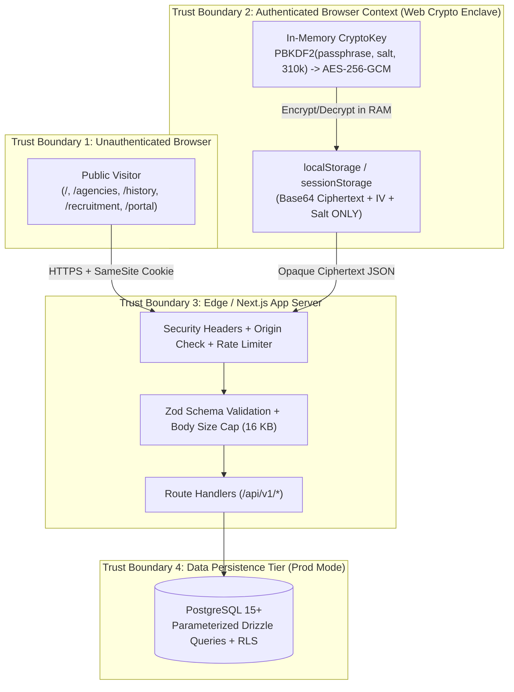

# AEGIS // OPS GRID — Security Architecture, Threat Model & OWASP Governance (`SECURITY.md`)

> **UNOFFICIAL FAN CONCEPT // FICTIONAL 2087 SPECULATIVE INTERFACE**  
> **DEMO MODE NOTICE**: When running in default `DEMO — not real security` mode (`AEGIS_MODE=demo`), THE GATE (`/portal`) accepts any shape-valid demo credential (`codename >= 3 chars`, `passphrase >= 8 chars`) so evaluators can explore the fictional 2087 watchfloor without provisioning an external identity store. However, the client-side **Field-Notes Vault (`/portal/vault`) uses genuine Web Crypto API `AES-256-GCM` with 310,000-iteration `PBKDF2-SHA256` key derivation** in all modes.

---

## 1. Threat Model

### 1.1 Protected Assets
1. **Operator Vault Field Notes (`vault_notes` / `aegis_vault_v1`)**: User-authored notes inside `/portal/vault`. Must remain encrypted (`AES-256-GCM`) at rest in `localStorage` and over the wire so plaintext never touches persistent storage.
2. **Candidate Application Packets (`applications`)**: Fictional recruitment submissions containing candidate codename, contact string (`contact_enc`), and aptitude answer grid.
3. **Session Integrity (`sessions` / `aegis_session`)**: Watchfloor authentication state guarding `/portal/*` and `/api/v1/{operations,dossiers,intercepts,vault}`.
4. **Application Availability & Runtime Purity**: Protecting the Next.js server against resource exhaustion (SSE flooding, oversized JSON payloads) and preventing any third-party script or asset injection (`NFR-001`, `NFR-005`).
5. **Legal & Factual Safety Integrity**: Preventing any confusion between this unofficial 2087 fan project and real-world government infrastructure.

### 1.2 Adversary Profiles
- **ADV-01 — Curious Visitor / Misinformed Bystander**: Unauthenticated visitor who probes `/portal/*` URLs directly or wonders if the site is an official government portal.
- **ADV-02 — Automated Credential Stuffer / Bot**: Script hammering `POST /api/v1/auth/session`, `POST /api/v1/recruitment/applications`, or opening hundreds of concurrent SSE connections to `/api/v1/intercepts/stream`.
- **ADV-03 — Web Attacker (XSS / CSRF / Injection)**: Adversary injecting malicious HTML/JS payloads into recruitment forms, query strings, or vault note fields, or attempting cross-origin state mutation.
- **ADV-04 — Infrastructure / DB Insider**: Operator with read access to PostgreSQL snapshots (`vault_notes`, `applications`) or browser `localStorage` inspection attempting to read user vault notes without the user's passphrase.

### 1.3 Trust Boundaries



---

## 2. Authentication, Session & Access Controls

### 2.1 Dual-Mode Authentication Contract
- **Demo Mode (`AEGIS_MODE=demo` — Explicitly Labeled `DEMO — not real security` in UI)**:
  - Verifies `codename.trim().length >= 3` and `passphrase.length >= 8` via Zod.
  - Signs a session token and sets cookie `aegis_session` (`Path=/; Max-Age=28800; SameSite=Lax`) plus `sessionStorage` state for immediate watchfloor evaluation.
- **Production Reference Mode (`AEGIS_MODE=production`)**:
  - Passphrases hashed using **`Argon2id`** (`memoryCost: 65536 KiB`, `timeCost: 3`, `parallelism: 4`).
  - Session IDs generated via `crypto.getRandomValues(new Uint8Array(32))` (256-bit entropy).
  - Production-reference cookie attributes: `__Host-aegis_session; HttpOnly; Secure; SameSite=Lax; Path=/; Max-Age=28800`. The shipped DEMO build deliberately drops `HttpOnly`/`__Host-` because the console guard reads the same token from `sessionStorage` and there is no real identity behind it; the flag is flipped in the production reference once the guard moves to server components.
  - **Session Rotation**: A fresh session ID is issued on every authentication privilege transition, and `DELETE /api/v1/auth/session` immediately invalidates both the server row and client cookie.

### 2.2 Authorization & Route Guarding
- Every `/portal/*` page checks session validity on mount and redirects unauthenticated visitors to `/portal?reason=auth_required`.
- Protected API endpoints (`/api/v1/operations`, `/api/v1/dossiers`, `/api/v1/intercepts/stream`, `/api/v1/vault/notes`) verify the session cookie/header before executing handler logic, returning `401 UNAUTHORIZED` if absent.

---

## 3. HTTP Security Headers & Content Security Policy (`NFR-005`)

All responses emitted by the application include hardened security headers, configured once in `next.config.ts` (`headers()` applies them to `/(.*)`, so static assets and route handlers inherit the same policy):

| Header | Configured Value | Purpose |
| :--- | :--- | :--- |
| `Content-Security-Policy` | `default-src 'self'; script-src 'self' 'unsafe-inline' 'unsafe-eval'; style-src 'self' 'unsafe-inline'; img-src 'self' data: blob:; font-src 'self' data:; connect-src 'self' https://*.e2b.app wss://*.e2b.app; media-src 'none'; object-src 'none'; base-uri 'self'; form-action 'self'` | Enforces zero third-party network egress (`NFR-001`) and blocks external script/font/image exfiltration. `script-src` carries `'unsafe-inline'`/`'unsafe-eval'` because the shipped build has no per-request nonce middleware (Next's hydration bootstrap is an inline script, and the dev compiler needs `eval`); the production reference deployment swaps this for a per-request nonce issued in `src/proxy.ts` and drops both keywords. `connect-src` lists the preview host so the SSE tap survives the sandbox proxy. |
| `Strict-Transport-Security` | `max-age=63072000; includeSubDomains; preload` | Enforces HTTPS for 2 years (`63,072,000` seconds). |
| `X-Content-Type-Options` | `nosniff` | Prevents MIME-sniffing attacks on API and static responses. |
| `Referrer-Policy` | `strict-origin-when-cross-origin` | Strips path/query sensitivity on cross-origin navigation. |
| `Permissions-Policy` | `camera=(), microphone=(), geolocation=(), payment=(), usb=(), interest-cohort=()` | Disables hardware sensors and browser tracking cohorts. |
| `X-DNS-Prefetch-Control` | `off` | Prevents speculative DNS lookups to external hosts. |

*(Note on Preview Environment Compatibility: In production deployments, `X-Frame-Options: DENY` and CSP `frame-ancestors 'none'` are enforced via `AEGIS_STRICT_FRAME_DENY=true`; in the sandboxed browser preview environment, iframe embedding remains compatible with the live preview host).*

---

## 4. Client-Side Cryptography Specification (`/portal/vault`)

The Field-Notes Vault (`src/lib/crypto.ts`) implements authenticated symmetric encryption entirely inside the browser via the W3C **Web Crypto API (`crypto.subtle`)**:

1. **Key Derivation (`PBKDF2-SHA256`)**:
   - Input: UTF-8 encoded user passphrase.
   - Salt: `16 bytes` (`128 bits`) generated via `crypto.getRandomValues(new Uint8Array(16))`.
   - Iterations: **`310,000` iterations** (OWASP 2023/2026 recommendation for `PBKDF2-HMAC-SHA256`).
   - Output: Non-extractable (`extractable: false`) 256-bit `AES-GCM` `CryptoKey`.
2. **Authenticated Encryption (`AES-256-GCM`)**:
   - Initialization Vector (IV): Fresh `12 bytes` (`96 bits`) random IV generated via `crypto.getRandomValues(new Uint8Array(12))` for **every single note encryption**. Never reused.
   - Authentication Tag: `128-bit` GCM integrity tag appended to ciphertext.
   - Storage Format (`aegis_vault_v1` in `localStorage` and `/api/v1/vault/notes`):
     ```json
     {
       "version": 1,
       "kdf": "PBKDF2-SHA256",
       "iterations": 310000,
       "cipher": "AES-256-GCM",
       "salt": "<base64-16-bytes>",
       "notes": [
         {
           "id": "vn-...",
           "iv": "<base64-12-bytes>",
           "ciphertext": "<base64-encrypted-payload-plus-128bit-gcm-tag>",
           "createdAt": "2026-11-10T18:00:00.000Z"
         }
       ]
     }
     ```
3. **Cryptographic Burn (Crypto-Shredding)**:
   - Executing the two-step **BURN ALL** sequence overwrites the storage slot, deletes all ciphertext records from `localStorage` and `/api/v1/vault/notes`, discards the in-memory `CryptoKey`, and generates a brand-new 128-bit `PBKDF2` salt—rendering any previously cached ciphertext mathematically unrecoverable.

---

## 5. Rate Limiting, Input Validation & Privacy Governance

### 5.1 Rate Limiting & Resource Caps
- **Authentication (`POST /api/v1/auth/session`)**: Capped at `5 attempts / 60 seconds` per client IP hash (`429 RATE_LIMITED` with `Retry-After: 60`).
- **SSE Intercept Stream (`GET /api/v1/intercepts/stream`)**: Capped at `1 concurrent stream` per session; automatically closes cleanly on `request.signal` abort.
- **Request Body Size Cap**: All `POST` / `PATCH` endpoints reject payloads exceeding `16 KB` (`16,384 bytes`) prior to schema parsing.
- **Universal Zod Validation**: Every API route validates inputs through strict Zod schemas with `.strict()` or explicit length/character constraints (`src/lib/schemas.ts`).

### 5.2 Privacy & Data Minimization
- **Application Contact Encryption**: Candidate contact strings submitted on `/recruitment` are explicitly marked as fictional handles and encrypted at rest (`contact_enc`).
- **Retention**: Application records are retained for $\le 12\text{ months}$; `audit_log` rows for $\le 13\text{ months}$.
- **Subject Rights (Export & Delete)**:
  - Operators can export all vault notes to a local `.txt` file (`EXPORT .TXT`) and permanently erase all records (`BURN ALL`) in two clicks.
  - Candidates can clear stored recruitment serials directly from the `/recruitment` terminal.
- **Audience**: Not directed at children under 16; collects zero real PII, telemetry cookies, or third-party analytics.

---

## 6. OWASP Top 10 (2021 / 2025) Control Mapping

| OWASP Category | Risk in AEGIS // OPS GRID | Implemented Engineering Control |
| :--- | :--- | :--- |
| **A01: Broken Access Control** | Unauthenticated access to `/portal/*` or cross-user access to `/api/v1/vault/notes`. | Client + server session guard (`FR-008`), `401/403` enforcement on cleared API routes, and Postgres Row-Level Security (`RLS`) on `vault_notes`. |
| **A02: Cryptographic Failures** | Storing plaintext notes in `localStorage` or weak password hashing. | Web Crypto `AES-256-GCM` with `PBKDF2-SHA256` (`310,000` iterations, random 96-bit IV, 128-bit salt); `Argon2id` password hashing in Prod Mode; HSTS 2-year header. |
| **A03: Injection (XSS / SQLi)** | Script injection via codename, vault notes, or SQL injection on filter queries. | React JSX auto-escaping, zero `dangerouslySetInnerHTML`, strict Zod input schemas, parameterized Drizzle ORM queries, and strict `Content-Security-Policy`. |
| **A04: Insecure Design** | Mistaking fictional portal for real agency system or leaking data to external CDNs. | Persistent top/bottom `UNOFFICIAL FAN CONCEPT` banners (`FR-002`), `[2087 SPECULATIVE FICTION]` stamps, and zero external runtime requests (`NFR-001`). |
| **A05: Security Misconfiguration** | Verbose stack traces, permissive CORS, or missing security headers. | Sanitized `{ ok: false, error: { code, message } }` envelope, strict security headers (`nosniff`, `Referrer-Policy`, `Permissions-Policy`, `CSP`), `.env.local` gitignored. |
| **A06: Vulnerable & Outdated Components** | Bloated third-party npm dependency tree with known CVEs. | Minimal dependency footprint (Next.js 16, React 19, Zod, native Web Crypto, inline SVG instead of heavy map/animation packages). |
| **A07: Identification & Authentication Failures** | Brute-force stuffing on `/api/v1/auth/session` or session fixation. | Token-bucket rate limiter (`5/min`), credential shape validation, session ID rotation on login, and immediate session purge on logout. |
| **A08: Software & Data Integrity Failures** | Unverified CDN scripts or tampered client vault payloads. | Zero external CDN scripts (`NFR-001`); `AES-256-GCM` 128-bit authentication tag detects any bit-flip tampering in stored vault ciphertext. |
| **A09: Security Logging & Monitoring Failures** | Unlogged auth failures or excessive PII in logs. | Structured `audit_log` capturing hashed IP (`ip_hash`), action code, and Zulu timestamp without logging passphrases or plaintext notes. |
| **A10: Server-Side Request Forgery (SSRF)** | Server tricked into fetching internal metadata URLs. | Webhook-less architecture (`API.md` §4); server never fetches user-supplied URLs and has zero outbound HTTP calls in request handlers. |

---

## 7. Incident Response Sketch

1. **Detection & Triage (`T+0m`)**:
   - Monitor `/api/v1/health` and `429 RATE_LIMITED` / `401 UNAUTHORIZED` spikes in `audit_log`.
2. **Containment (`T+5m`)**:
   - Rotate `AEGIS_SESSION_SECRET` in environment configuration and truncate `sessions` table (`TRUNCATE TABLE sessions;`) to force global watchfloor re-authentication.
3. **Eradication & Crypto Verification (`T+15m`)**:
   - Because `vault_notes` contains only client-derived `AES-256-GCM` ciphertext and the server never holds user passphrases or derived `CryptoKey`s, a server storage compromise exposes zero plaintext field notes.
4. **Recovery & Post-Mortem (`T+60m`)**:
   - Deploy patched container image, verify `npm run test` and `npm run build`, and publish incident summary in repository release notes.
