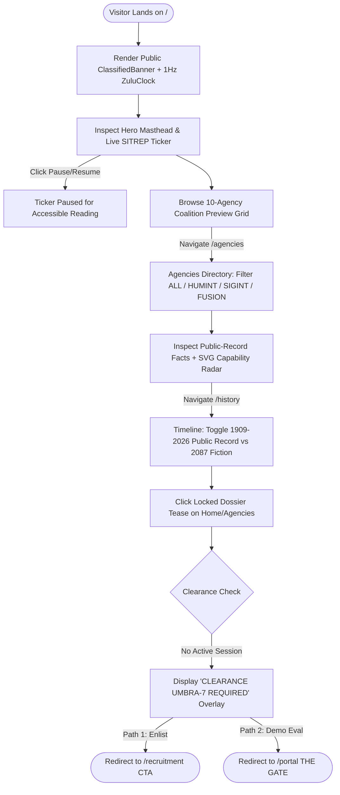
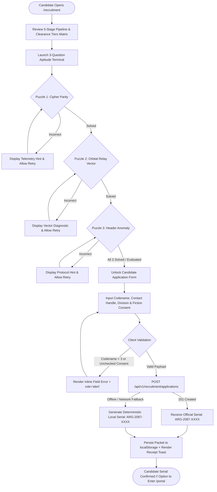
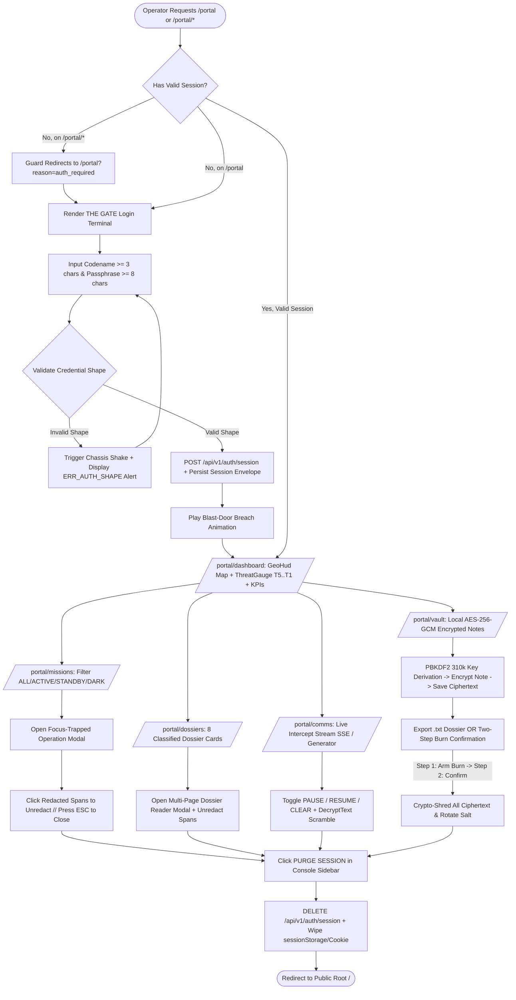

# AEGIS // OPS GRID — User Flows & State Machines (`USER_FLOWS.md`)

> **UNOFFICIAL FAN CONCEPT // FICTIONAL 2087 SPECULATIVE INTERFACE**  
> This document defines end-to-end interaction flows, error recovery paths, and state machines for the three primary personas of **AEGIS // OPS GRID**. All flows preserve explicit demarcation between public-record agency facts and fictional 2087 operations.

---

## 1. Persona Flow A — Civilian Curious Visitor ("The Archivist")

### 1.1 Narrative Walkthrough
1. **Entry (`GET /`)**: Visitor lands on the public Directorate root. The `PowerOn` flicker settles (or bypasses under `prefers-reduced-motion`). The top/bottom `ClassifiedBanner` establishes the unofficial 2087 fan-concept context.
2. **SITREP Ticker Hook**: Visitor observes the live 2087 SITREP ticker scrolling across the masthead, pauses it via keyboard/click to inspect an orbital anomaly bulletin, and scrolls down to the 10-agency coalition preview grid.
3. **Agencies Deep Dive (`/agencies`)**: Visitor navigates to `/agencies`, toggles the category filter from `ALL` → `SIGINT` (highlighting `GCHQ` and `NSA`) → `HUMINT` (highlighting `CIA`, `MI6/SIS`, `R&AW`, `Mossad`, `ASIS`) → `FUSION` (`BND`, `DGSE`, `CSIS`), and inspects the SVG capability radar and verified public-record founding facts.
4. **History Verification (`/history`)**: Visitor checks `/history` to compare `1909–2026 [PUBLIC RECORD]` intelligence milestones against `2054–2087 [2087 SPECULATIVE FICTION]` capstones.
5. **Locked Dossier Tease & Conversion**: Returning to `/` or clicking a locked dossier preview prompts the visitor with two forward paths: apply as a candidate via `/recruitment` or authenticate at `/portal` using demo credentials.

### 1.2 Mermaid Flowchart — Flow A (Civilian Explorer)

---

## 2. Persona Flow B — Prospective Recruit ("SIGNAL")

### 2.1 Narrative Walkthrough
1. **Entry (`GET /recruitment`)**: Candidate arrives at the Directorate Recruitment Terminal and reviews the **5-Stage Intake Pipeline** (`SIGNAL INTAKE` → `COGNITIVE MATRIX` → `ZERO-TRUST VETTING` → `TRADECRAFT CRUCIBLE` → `UMBRA INDOC`) and the **4 Clearance Tiers Table**.
2. **Cryptographic Aptitude Terminal (3 Puzzles)**:
   - **Puzzle 01 (Cipher/Sequence Analysis)**: Candidate decodes a hex/modular progression key and receives instant diagnostic telemetry (`LOCK ACQUIRED` or `PARITY MISMATCH — RETRY`).
   - **Puzzle 02 (Geostationary Triangulation)**: Candidate identifies which allied station bridges an orbital relay gap between Cheltenham (`GCHQ`) and Canberra (`ASIS`).
   - **Puzzle 03 (Compartmentation Logic)**: Candidate spots the anomaly in a synthetic zero-trust transmission header.
3. **Application Packet Submission**:
   - Candidate enters `codename` ($\ge 3$ alphanumeric/hyphen chars), `contact` (fictional comms handle), `specialty`, and checks `consent` acknowledging the fictional simulation.
   - Client-side validation runs immediately; if invalid, inline `aria-invalid="true"` alerts specify the field error.
4. **API Persistence & Serial Issuance**:
   - Client dispatches `POST /api/v1/recruitment/applications` with `Idempotency-Key`.
   - Server validates payload via schema and returns `201 Created` with deterministic serial `ARG-2087-XXXX`.
   - If the API is unreachable (offline mode), the client fallback deterministically generates `ARG-2087-XXXX` locally and stores the packet in `localStorage.getItem("aegis_applications_v1")`.

### 2.2 Mermaid Sequence & Flowchart — Flow B (Recruit Pipeline)

---

## 3. Persona Flow C — Cleared Watchfloor Analyst ("UMBRA-EYES" Demo Persona)

### 3.1 Narrative Walkthrough
1. **The Gate (`/portal`)**:
   - Analyst arrives at `/portal`. If arriving via an unauthenticated redirect from `/portal/*`, a banner displays `SESSION REQUIRED // AUTHENTICATE AT GATE`.
   - Analyst enters `codename` ($\ge 3$ chars, e.g., `KESTREL-9`) and `passphrase` ($\ge 8$ chars, e.g., `OBSIDIAN-2087`) or clicks **LOAD DEMO CREDENTIALS**.
   - If credentials fail shape validation (`codename < 3` or `passphrase < 8`), the terminal chassis executes a 360ms horizontal error shake and logs `ERR_AUTH_SHAPE: MINIMUM 3-CHAR CODENAME / 8-CHAR PASSPHRASE REQUIRED`.
   - On valid submission, `POST /api/v1/auth/session` returns an `UMBRA-7` session token, stored in `sessionStorage` (`aegis_session_v1`) and an HTTP cookie (`aegis_demo_session`). The mechanical blast-door animation parts (`650ms`) and routes to `/portal/dashboard`.
2. **Watchfloor Dashboard (`/portal/dashboard`)**:
   - `ConsoleShell` verifies session validity. Analyst inspects the 4 KPI cards, adjusts or inspects the SVG `ThreatGauge` (`T5..T1`), clicks city and anomaly blips on the SVG `GeoHud` world map to view live station telemetry, and reviews the top-4 active operations.
3. **Missions Console (`/portal/missions`)**:
   - Analyst filters operations (`ALL` / `ACTIVE` / `STANDBY` / `DARK`), opens Operation `GLASS HORIZON` in a focus-trapped `<Modal />`, clicks `<Redacted />` spans to declassify sensitive coordinates, and closes the modal via `ESC`.
4. **Dossiers Archive (`/portal/dossiers`)**:
   - Analyst browses the 8 intelligence dossiers, filters by classification (`UMBRA-7` / `ORCON` / `EYES ONLY`), opens a multi-page dossier modal, unredacts embedded tokens, and dismisses the reader.
5. **Live Comms Intercepts (`/portal/comms`)**:
   - Analyst watches auto-streaming synthetic intercepts arrive with `<DecryptText />` character-scramble animations, clicks `PAUSE STREAM` to inspect a `FLASH` quantum burst, filters by classification, and clicks `CLEAR BUFFER` or `RESUME STREAM`.
6. **Encrypted Field-Notes Vault (`/portal/vault`)**:
   - Analyst enters a field note title and body, encrypts it client-side with `AES-256-GCM` (`PBKDF2` 310k iterations), inspects the live Base64 ciphertext + IV inspector, exports a `.txt` archive, and executes the two-step **BURN ALL** sequence (`ARM BURN` → `CONFIRM CRYPTO-SHRED`).
7. **Session Purge**:
   - Analyst clicks `PURGE SESSION` in the console sidebar/topbar. `sessionStorage` and cookies are wiped, `DELETE /api/v1/auth/session` fires, and the analyst is returned cleanly to `/`.

### 3.2 Mermaid Flowchart — Flow C (Cleared Watchfloor & Error Paths)

---

## 4. Error & Edge-Case Recovery Paths

| Error Scenario | Trigger Condition | System Response | User Recovery Path |
| :--- | :--- | :--- | :--- |
| **Invalid Gate Credentials** | `codename.trim().length < 3` or `passphrase.length < 8` on `/portal` | Suppresses session creation; triggers `shake` animation (unless reduced-motion); sets `aria-live="assertive"` error banner `ERR_AUTH_SHAPE`. | Correct input lengths or click **LOAD DEMO CREDENTIALS** button. |
| **Unauthenticated Console Access** | Direct navigation to `/portal/dashboard`, `/portal/missions`, `/portal/dossiers`, `/portal/comms`, or `/portal/vault` with missing/expired session | `ConsoleShell` guard halts confidential view rendering and redirects immediately to `/portal?reason=auth_required&next=<path>`. | Authenticate at `/portal`; automatically forwarded to intended console route. |
| **Expired Watchfloor Session** | Current UTC time exceeds `session.expiresAt` while inside `/portal/*` | Session verifier clears stale token, displays toast `SESSION TTL EXPIRED // RE-AUTHENTICATE`, and redirects to `/portal`. | Re-authenticate at `/portal` (encrypted vault ciphertext in `localStorage` remains safely intact). |
| **Offline / Degraded API Endpoint** | `fetch('/api/v1/...')` fails due to network disconnect or static export mode | Client service layer catches network error, falls back seamlessly to local deterministic data/crypto handlers, and badges status as `LOCAL AUTONOMOUS MODE`. | Zero interruption to user workflow; all operations, dossiers, intercepts, and vault actions continue working. |
| **Vault Passphrase Mismatch** | Operator enters a custom decryption passphrase that differs from the key used to encrypt existing notes | `crypto.subtle.decrypt` throws `OperationError` (GCM authentication tag failure); UI keeps ciphertext untouched and shows `GCM TAG VERIFICATION FAILED — WRONG PASSPHRASE`. | Re-enter original passphrase or execute two-step vault reset if starting fresh. |
| **Unknown URL Route** | Request to any path outside the 10 defined routes (e.g., `/sector-99`) | Next.js renders `src/app/not-found.tsx` (`"YOU ARE OFF THE MAP"`). | Click `RETURN TO PUBLIC DIRECTORATE (/)` or `RE-ESTABLISH WATCHFLOOR LINK (/portal)`. |

---

## 5. Application State Transition Table

| Domain | State Name | Storage Location | Initial State | Transition Trigger | Next State | Side Effects |
| :--- | :--- | :--- | :--- | :--- | :--- | :--- |
| **Auth Session** | `UNAUTHENTICATED` | `sessionStorage` + Cookie | `null` | Valid submit on `/portal` (`codename >= 3`, `passphrase >= 8`) | `AUTHENTICATED (UMBRA-7)` | Writes `aegis_session_v1`, sets cookie, plays door open, routes to `/portal/dashboard`. |
| **Auth Session** | `AUTHENTICATED (UMBRA-7)` | `sessionStorage` + Cookie | `{ sessionId, codename, clearance, expiresAt }` | Click `PURGE SESSION` or TTL expiry | `UNAUTHENTICATED` | Clears `sessionStorage` & cookie, calls `DELETE /api/v1/auth/session`, routes to `/portal` or `/`. |
| **Redaction Span** | `REDACTED` | Component State | `revealed: false` | Click or `Enter`/`Space` on `<Redacted />` or `DECLASSIFY ALL` | `DECLASSIFIED` | Reveals plaintext in cyan phosphor, sets `aria-expanded="true"`. |
| **Case/Dossier Modal** | `CLOSED` | Component State | `activeId: null` | Click Mission or Dossier card | `OPEN (FOCUS_TRAPPED)` | Locks background scroll, moves focus into modal close/header button. |
| **Case/Dossier Modal** | `OPEN (FOCUS_TRAPPED)` | Component State | `activeId: string` | Press `ESC`, click backdrop, or click `[X] CLOSE` | `CLOSED` | Restores keyboard focus to the exact card button that opened the modal. |
| **Comms Stream** | `STREAMING` | Component State | `isPaused: false` | Click `PAUSE STREAM` | `PAUSED` | Halts interval/SSE append so operator can inspect frames without scroll shift. |
| **Vault Burn** | `DISARMED` | Component State | `burnStep: 0` | Click `BURN ALL NOTES` | `ARMED (CONFIRM_PENDING)` | Reveals secondary warning button `CONFIRM CRYPTO-SHRED` + `CANCEL` timer. |
| **Vault Burn** | `ARMED (CONFIRM_PENDING)` | Component State | `burnStep: 1` | Click `CONFIRM CRYPTO-SHRED` | `SHREDDED -> DISARMED` | Overwrites & removes `aegis_vault_v1` in `localStorage`, generates new 128-bit PBKDF2 salt, emits toast. |
